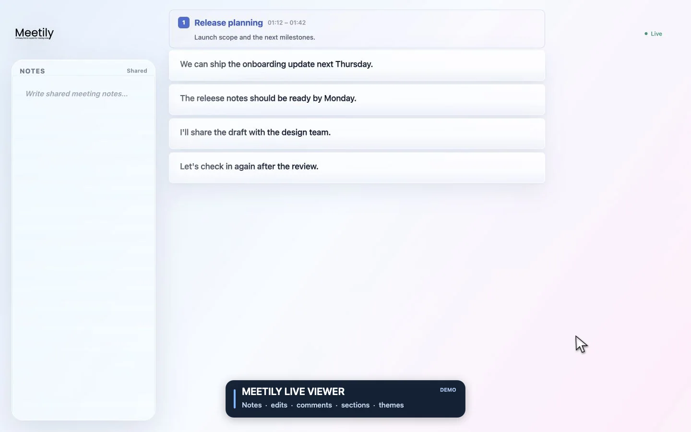

# Meetily Live Viewer

A fork of [Meetily](https://github.com/Zackriya-Solutions/meetily) that adds an External Web UI for viewing and annotating a desktop session from a browser. This README covers the fork-specific UI; use the upstream README for Meetily installation, core features, architecture, and general development.

<p align="center">
  
</p>

The animation uses sample meeting data.

## What this fork adds

- Live transcript updates over WebSocket.
- Shared, editable meeting Notes.
- Transcript corrections saved as revisions.
- Section markers with titles and descriptions.
- Comments and TODO/FIXME highlights attached to transcript segments.

## Use the External Web UI

When the Meetily desktop app is running, its built-in server serves the UI at:

- This computer: <http://localhost:38391/>
- Another device on the same network: `http://<HOST-IP>:38391/`

The server must be reachable from the other device for LAN access. See [Security](#security) before enabling it on a network.

- Write in **Notes** to capture shared meeting notes; changes save automatically.
- Select a transcript line, press **Enter**, edit the text, and choose **Save**.
- Select a transcript line and press **⌘ Enter** (or **Ctrl Enter**) to add a comment, then choose **Send**.
- Hover between transcript lines, select **+**, enter a section title, and choose **Create**.
- To change the theme, move the pointer to the top center to open the command bar (or press `⌘ P` on macOS), type `>`, and select **Theme**.

## Develop the web UI

Requirements: Node.js 20.19 or newer and pnpm.

```bash
cd ext-frontend
pnpm install
pnpm dev
```

Open <http://localhost:5173/>. Vite proxies `/api`, `/health`, and `/ws` to `127.0.0.1:38391` by default, so run Meetily on the same computer to connect to a live session.

To build the UI from the repository root:

```bash
cd ext-frontend
pnpm build
```

The build writes to `ext-frontend/dist`. The desktop app bundles this directory and serves it from its built-in server; a separate Vite server is only needed for UI development. See the [upstream build guide](https://github.com/Zackriya-Solutions/meetily#for-developers) for building the desktop app.

## Security

Treat the External Web UI as a network-accessible interface to meeting data. Its API can read and change transcripts, Notes, sections, comments, and highlights.

- By default, the server listens on `0.0.0.0:38391` and `MEETILY_EXT_TOKEN` is unset. That means API and WebSocket access has no authentication; a token is **not** generated automatically.
- For access from this computer only, set `MEETILY_EXT_BIND=127.0.0.1:38391` before launching Meetily.
- For LAN access, set a strong `MEETILY_EXT_TOKEN` in the environment used to launch Meetily. Open `http://<HOST-IP>:38391/?token=<token>`; the frontend stores the supplied token in browser local storage.
- Even when a token is configured, `/health` and the static UI are public. API and WebSocket routes require the token.
- The built-in server uses plaintext HTTP and WebSocket and does not provide TLS. The token is passed in the URL, so treat that URL as a secret. Do not expose port `38391` directly to the public internet; use a trusted network and firewall, or an encrypted VPN or TLS reverse proxy for remote access.
- Leave `MEETILY_EXT_CORS_PERMISSIVE` unset for normal use. Setting it to `true` enables permissive CORS.

Example for a local-only listener with token authentication:

```bash
export MEETILY_EXT_BIND="127.0.0.1:38391"
export MEETILY_EXT_TOKEN="$(openssl rand -hex 32)"
# Launch Meetily from this shell so it inherits these variables.
```

For LAN access, use a LAN-reachable bind address and restrict port `38391` to trusted devices with your firewall.
